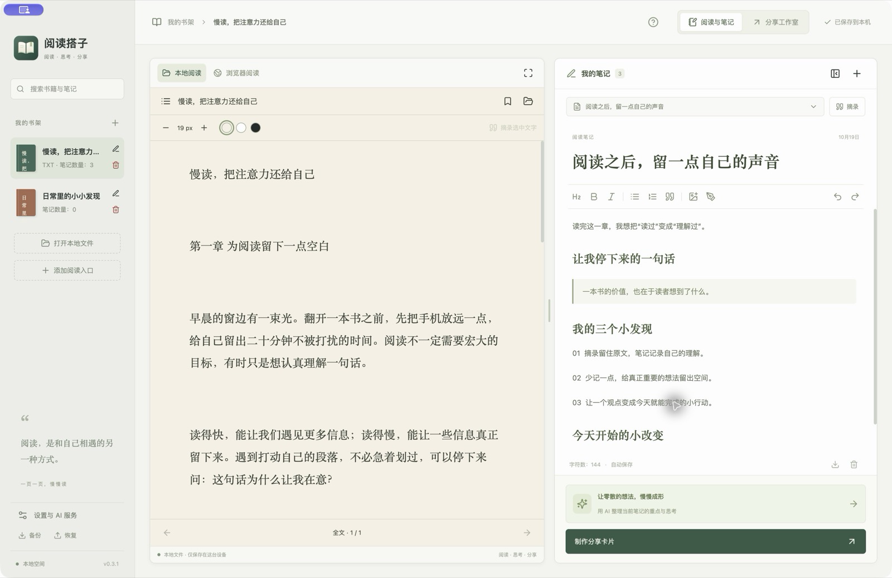
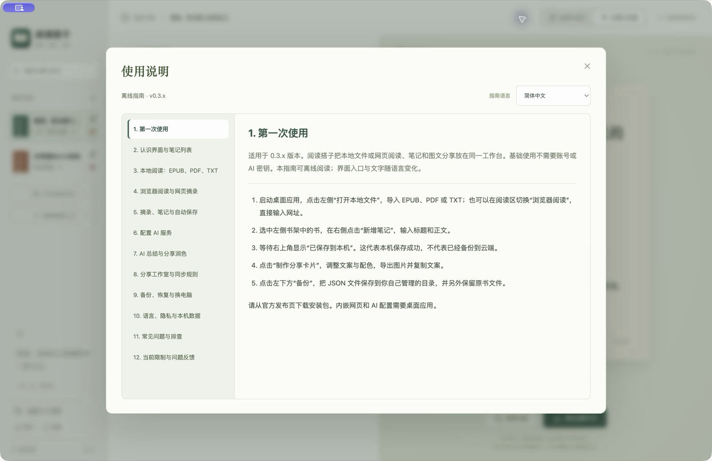

# 阅读搭子 · Reading Companion

[English](README.en.md) · [使用说明](docs/USER_GUIDE.md) · [下载软件](https://github.com/xululu0401/reading-companion/releases/latest) · [反馈问题](https://github.com/xululu0401/reading-companion/issues)

把阅读、笔记和图文分享放在同一工作台：左侧读本地书或网页，右侧记录想法，再制作分享卡片。

### [⬇ 下载 macOS 版（M 系列芯片）](https://github.com/xululu0401/reading-companion/releases/download/v0.3.2/Reading-Companion-0.3.2-mac-arm64.zip)

版本 **0.3.2** · ZIP 安装包 · [安装说明](#下载与安装) · [更新记录](https://github.com/xululu0401/reading-companion/releases/latest)

一边阅读，一边记录。拖动中间分隔线调整宽度，也可以进入专注阅读或写作。

## 下载与安装

点击上方下载链接即可获得安装包，无需展开 Releases 的附件列表。

| 平台 | 当前提供 |
| --- | --- |
| macOS / Apple Silicon（M 系列） | [下载 0.3.2 ZIP 安装包](https://github.com/xululu0401/reading-companion/releases/download/v0.3.2/Reading-Companion-0.3.2-mac-arm64.zip) |
| macOS / Intel | 暂未提供 |
| Windows / Linux | 暂未提供安装包，尚未完成界面验证 |

解压后将「阅读搭子.app」放入 Applications。0.3.2 已修复应用签名完整性问题，使用本地（ad-hoc）签名；尚未进行 Developer ID 签名和 Apple 公证，macOS 仍可能阻止打开。请保留系统安全保护，签名与公证将在后续完善。安装前可按 Release 的 SHA256SUMS.txt 核对文件完整性；哈希不能替代开发者签名。

国内独立下载线路尚未配置；本仓库不宣称 GitHub 在所有国内网络下都能稳定访问。

## 当前能力

- EPUB / PDF / TXT 本地阅读，目录、书签与进度保存；无书籍时也可直接浏览网页。
- 网页地址栏、阅读直达入口、选区或复制后的摘录、书架添加与删除。
- 富文本笔记、图片、简单手绘、自动保存、JSON 备份和 Markdown 导出。
- 自带 API Key 的多服务 AI 配置、笔记总结与分享文案。
- 图文卡片、封面、长文分页、PNG 导出与复制文案；用户自行去社交平台发布。
- 简体、繁体、英语、日语和西班牙语；离线使用说明。

第三方网站、模型和账号权限由各自提供方决定。自定义划选页面可能需要先点网站的“复制”，再右键“粘贴为阅读摘录”。

## 软件截图

### 把笔记变成分享卡片

编辑标题与正文，选择配色，实时预览并导出图片。

### 随时查阅使用说明

内置五种语言的离线指南，覆盖阅读、笔记、AI 配置、分享和备份。

截图来自实际桌面应用，书籍与笔记均为原创演示内容。

## 开始使用

1. 打开本地 EPUB/PDF/TXT，或切换“浏览器阅读”输入网址。
2. 在右侧写笔记；等待顶栏显示“已保存到本机”。
3. 点击“制作分享卡片”，编辑并导出图片。
4. 定期点左下角“备份”，并单独保留原书。JSON 不含原书文件、网页登录或 API 密钥。
5. 点击顶栏问号查看完整指南。删书会一起删除关联笔记与分享稿，确认前可备份。

## 功能范围与费用

当前尚未提供完整 Goodnotes 手写能力、OCR、PDF 批注、书内全文搜索、云同步、自动发布或官方托管 AI。当前没有账号、订阅、支付或自动更新系统。真实服务商接口和各网站兼容性尚未全面验证，翻译仍需母语校对。

基础功能免费使用。未来可能提供可选的付费功能或服务，不影响基础功能的免费使用；AI 等第三方服务费用由相应服务商收取。

## 隐私、许可与反馈

- 书籍和笔记保存在本机，无默认云同步。AI 生成只按用户操作发送当前笔记文字、标题及书名，详见 [隐私说明](docs/PRIVACY.md)。
- 软件使用条款见 [许可证](LICENSE)。欢迎分享官方下载链接。
- 阅读搭子是独立产品，与微信读书等阅读或社交平台无隶属关系。
- 第三方组件仍遵循各自许可，见 [第三方声明](THIRD_PARTY_NOTICES.md) 及安装包内的 Electron 声明。
- 普通问题请提交 [Issue](https://github.com/xululu0401/reading-companion/issues)，说明版本、系统和复现步骤，勿上传真实密钥、私人笔记或受版权限制的书籍。
- 安全问题见 [安全反馈](SECURITY.md)。
